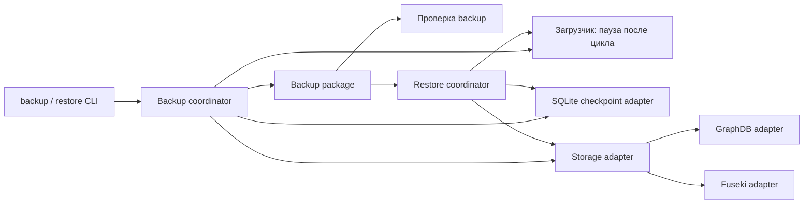
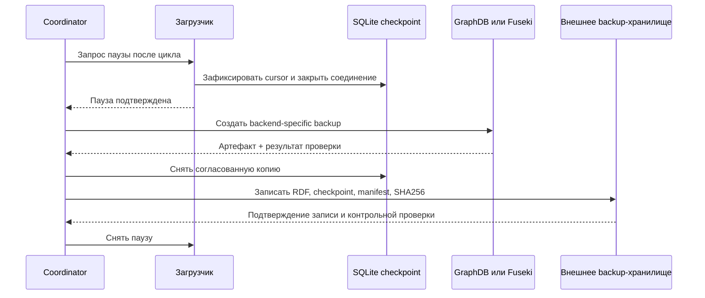

# Архитектура резервного копирования и восстановления

## Статус реализации

GraphDB- и Fuseki-версии реализованы в `pipelines/backup`; доступны создание, проверка и восстановление парного backup-пакета. Для штатного онлайн-режима нужен loader-образ с Fuseki backup CLI и поддержкой паузы после цикла; для образов без барьера предусмотрен проверяемый offline-режим. На работающем Fuseki можно создать пакет и восстановить его на тот же dataset; live-восстановление в этой рабочей базе ещё не выполнялось.

## Цель

Механизм должен сохранять согласованную пару: состояние RDF-хранилища и SQLite checkpoint загрузчика, описывающий, до какого S3-события эти графы применены. Общие правила упаковки, проверки и восстановления используются обоими backend; создание и восстановление RDF-данных выполняют отдельные адаптеры GraphDB и Fuseki.

Backup сохраняет фактическое текущее состояние выбранного dataset вместе с checkpoint. Перед созданием пакета проверьте, что URL, dataset и checkpoint принадлежат одной связке; значения статистики считываются до и после операции и записываются в manifest.

## Общая архитектура



Coordinator управляет последовательностью операций, точкой согласования, manifest, контрольными суммами и внешним хранилищем. Storage adapter реализует общий интерфейс:

```text
backup(target, backup_id) -> artifact + metadata
verify(artifact, metadata) -> validation_report
restore(artifact, target, mode) -> restore_report
```

Для нового backend добавляется адаптер; формат общей метаинформации и управление checkpoint остаются прежними.

## Согласование checkpoint и хранилища

Загрузчик поддерживает управляемый барьер, позволяющий приостановиться после завершения цикла:

1. Coordinator запрашивает паузу с уникальным `backup_id`.
2. Загрузчик заканчивает текущий цикл, ждёт завершения всех операций записи в RDF и фиксирует SQLite checkpoint.
3. Загрузчик сообщает состояние `paused`, последний завершённый run и позицию checkpoint; закрывает соединение SQLite и ожидает команды продолжения.
4. Пока пауза действует, coordinator создаёт RDF backup и копию checkpoint.
5. После проверки и сохранения пакета coordinator снимает паузу.

В реализованном варианте backup-контейнер атомарно создаёт `backup.request.json` в общем checkpoint volume. Загрузчик замечает запрос на границе цикла, закрывает SQLite соединение, сохраняя lock, и публикует `state=paused` и `maintenance.backup_id` в `status.json`. После удаления запроса он открывает checkpoint и продолжает работу. Backup CLI ждёт подтверждение и снимает запрос после окончания операции.

Если используемый loader-образ ещё не поддерживает этот барьер, разрешён offline-режим: сначала убедиться, что `status.json` показывает `waiting` или `idle`, штатно остановить загрузчик, затем запустить `create --offline` или `restore --offline`. CLI дополнительно захватывает checkpoint lock и отменит операцию, если загрузчик всё ещё открыт или последняя запись статуса указывает, что цикл не завершён. Обычная остановка без этой проверки не является безопасным барьером.

SQLite checkpoint следует копировать через SQLite Backup API. Альтернатива — корректно закрыть соединение, выполнить checkpoint WAL и копировать БД вместе с необходимыми файлами. Копирование только активного файла БД не гарантирует согласованности.

## Формат backup-пакета

```text
backup-<backup_id>/
  store/
    graphdb-repository.tar       # GraphDB native backup
    # либо fuseki-dataset.nq.gz  # Fuseki/TDB2 logical backup
  checkpoint.sqlite
  manifest.json
  SHA256SUMS
```

`manifest.json` содержит:

- версию формата manifest, `backup_id`, UTC-время создания и статус проверки;
- backend и логическое имя repository/dataset, версию движка и не секретный target identity;
- вид backup-артефакта, относительный путь, формат, размер и SHA-256;
- имя и контрольную сумму SQLite checkpoint;
- последний применённый S3 run/manifest, cursor/checkpoint, portal и prefix без credentials;
- версию/fingerprint mappings и версию либо digest образа загрузчика;
- контрольные показатели RDF: число именованных графов, число триплетов, результат проверки выборочных графов.

В пакет не включаются пароли, S3 access keys, токены и содержимое конфигурации с секретами. Внешнее хранилище должно быть отделено от Docker-хоста, зашифровано и иметь ограниченные права записи/чтения.

## Адаптер GraphDB

Для работающего GraphDB 11.5.2 адаптер использует Recovery REST API:

- Backup: `POST /rest/recovery/backup`, ограничив `repositories` целевым repository `fuseki_migration_monitor`.
- По умолчанию `backupSystemData` выключен: пользовательские настройки и данные управления GraphDB хранятся отдельно, если явно не требуется резервировать их тоже.
- Backup считается пригодным только после успешного ответа, наличия `.success` внутри `.tar`, вычисления SHA-256 и проверки метаданных.
- Restore выполняется через `POST /rest/recovery/restore` multipart-запросом и только для нужного repository. Не задавать `removeStaleRepositories`, если удаление других repositories не является отдельной намеренной операцией.
- Команда `create` запрашивает pause barrier, сохраняет `.tar` и согласованную копию SQLite в один пакет, записывает `manifest.json` и `SHA256SUMS`, затем снимает паузу.
- Команда `verify` проверяет SHA-256 артефактов, целостность SQLite и наличие `.success` в GraphDB-архиве.
- Команда `restore` проверяет backend, имя repository и checkpoint identity до изменения базы, требует `--confirm-repository` с точным именем, восстанавливает repository, затем атомарно заменяет checkpoint. Если запрос восстановления GraphDB уже начат и завершился ошибкой, загрузчик остаётся на паузе до ручной проверки.
- Recovery API использует `graphdb.backup_username/password`, если они заданы; иначе применяются `graphdb.username/password`. Если GraphDB сообщает `security=false`, адаптер работает без credentials. Если security включена, CLI проверяет вход и наличие `ROLE_ADMIN` до паузы загрузчика. Секреты хранятся в игнорируемом `deploy/graphdb/config.yaml`.
- Запрос паузы находится в `backup.request.json` внутри checkpoint volume. Загрузчик сохраняет свою SQLite lock на всё время паузы, чтобы другой экземпляр не начал синхронизацию параллельно.

GraphDB требует, чтобы экземпляр был запущен для операций Recovery API. Для восстановления целевой repository должен иметь ту же identity, что записана в пакете; перепривязка checkpoint на другой endpoint не поддерживается. Восстановление в изолированной цели с совместимой версией GraphDB ещё предстоит выполнить. SQLite вручную не редактировать.

Нативный GraphDB `.tar` предназначен для восстановления в GraphDB и не заменяет переносимый RDF-экспорт.

## Адаптер Fuseki/TDB2

Адаптер в `pipelines/backup/fuseki.py`:

1. проверяет доступ к admin API и наличие настроенного dataset;
2. фиксирует исходный список файлов через `GET /$/backups-list`, вызывает `POST /$/backup/{dataset}` и опрашивает `GET /$/tasks/{taskId}` до `success=true`;
3. находит только новый завершённый `.nq.gz` в `FUSEKI_BASE/backups`, проверяет gzip CRC до конца файла и копирует его в пакет;
4. до и после backup сравнивает статистику dataset, чтобы обнаружить сторонние изменения;
5. сохраняет N-Quads вместе с checkpoint, manifest и SHA-256.

Backup Compose находится в `deploy/fuseki/compose.yaml`. Он подключается к сети действующего Fuseki, монтирует его `FUSEKI_BASE/backups` и тот же внешний loader checkpoint volume. Fuseki должен быть запущен и предоставить административные права на `/$/backup`, `/$/backups-list` и `/$/tasks`. Путь в `fuseki.backup_directory` внутри конфигурации должен быть `/fuseki/backups`; соответствующую host-папку задаёт `FUSEKI_BACKUP_DIR`.

Восстановление отправляет проверенный gzip N-Quads через dataset-level quad `PUT` на Fuseki Graph Store endpoint (`/data`, `Content-Type: application/n-quads`). Jena поддерживает quad PUT как замену dataset; операция выполняется Fuseki/TDB2 как транзакция. Перед заменой адаптер запрашивает ещё один временный backup текущего dataset. Если PUT или сверка числа графов/квадов завершается ошибкой, адаптер возвращает исходный dataset из этого временного backup, а checkpoint не заменяет. При неудаче самого отката загрузчик остаётся на паузе для ручной диагностики. Checkpoint атомарно заменяется только после совпадения статистики восстановленного dataset с manifest.

Реализованный путь восстановления требует работающего Fuseki с включёнными quad update операциями. Он заменяет весь dataset; восстановление только отдельных именованных графов не выполняется. Проверка live-восстановления в рабочей базе не выполнялась.

## Восстановление

1. Проверить manifest, SHA-256 всех файлов, GraphDB `.success` либо полную gzip целостность Fuseki N-Quads.
2. Остановить или приостановить целевой загрузчик.
3. Для GraphDB восстановить repository через Recovery API; для Fuseki выполнить dataset-level quad PUT, который заменяет весь dataset в одной транзакции.
4. Восстановить SQLite checkpoint из того же backup-пакета.
5. Проверить число графов/триплетов, выборочные графы, checkpoint integrity, backend identity и совпадение позиции с manifest.
6. Восстанавливать пакет можно только в тот же backend и endpoint, что записаны в manifest; механизм не перепривязывает checkpoint к другой цели.
7. Запустить один цикл загрузчика и проверить, что он догнал последний завершённый S3 run. Затем включить регулярную синхронизацию.

S3 должен хранить достаточно долго manifests и файлы событий, на которые ссылается checkpoint: без этих объектов загрузчик может не суметь догнать состояние после backup. Резервный пакет сохраняет уже загруженный RDF, но сам по себе не восстанавливает удалённые исходные объекты S3.



## Команды и компоненты

Общие команды:

- `backup create` — запрос паузы, backup хранилища и checkpoint, упаковка и проверка;
- `backup verify` — проверка пакета без изменения хранилища;
- `backup restore` — восстановление после явного подтверждения целевого GraphDB repository или Fuseki dataset;
- `backup resume` — снять зависшую паузу после ручной проверки RDF и checkpoint.

В GraphDB-версии команды доступны через профиль Compose. Backup создаётся в каталоге хоста `deploy/graphdb/backups/graphdb` (он исключён из Git):

```bash
export LOADER_IMAGE_TAG=<тег-образа-с-backup-поддержкой>
docker compose -p semantic_bi_graphdb -f deploy/graphdb/compose.yaml run --rm backup
```

Для проверки существующего пакета:

```bash
docker compose -p semantic_bi_graphdb -f deploy/graphdb/compose.yaml run --rm backup \
  --config /run/secrets/loader_config verify /backups/<backup-id>
```

Восстановление изменяет выбранный repository и checkpoint; сначала убедитесь, что выбран правильный пакет и цель:

```bash
docker compose -p semantic_bi_graphdb -f deploy/graphdb/compose.yaml run --rm backup \
  --config /run/secrets/loader_config restore /backups/<backup-id> \
  --confirm-repository fuseki_migration_monitor
```

Опция `--offline` нужна, если используемый loader-образ не обрабатывает pause barrier. Загрузчик нужно вручную остановить **только после** того, как его status-файл показывает `waiting` или `idle`. Команда дополнительно захватывает checkpoint lock и откажется работать, если статус показывает, что остановка могла произойти внутри цикла.

```bash
docker compose -p semantic_bi_graphdb -f deploy/graphdb/compose.yaml run --rm backup \
  --config /run/secrets/loader_config create --offline --output /backups
```

Для offline restore добавьте `--offline` в команду `restore`. После успешного восстановления снова запустите загрузчик. Для образа с pause barrier используйте обычные `create`/`restore` без `--offline`: загрузчик сам приостановится после завершения цикла.

Если восстановление было начато, но команда сообщила об ошибке, загрузчик оставляется на паузе. После диагностики используйте `resume` только когда RDF и checkpoint согласованы:

```bash
docker compose -p semantic_bi_graphdb -f deploy/graphdb/compose.yaml run --rm backup resume
```

Путь backup можно вынести из каталога проекта через `GRAPHDB_BACKUP_DIR=/абсолютный/путь`. Compose-сервис backup запускается только командой `run`, не входит в постоянный `up`.

### Fuseki

Подготовьте локальную конфигурацию с тем же checkpoint, которым пользуется Fuseki-загрузчик. Если локальный `deploy/loader/config.yaml` уже настроен для Fuseki, скопируйте его. Иначе начните с `deploy/fuseki/config.example.yaml` и заполните его значениями S3 и хранилища. Проверьте, что `backend: fuseki`, URL указывает на нужный dataset, а `checkpoint.path` — `/var/lib/semantic-bi/state.sqlite3`:

```bash
cp deploy/loader/config.yaml deploy/fuseki/config.yaml
chmod 600 deploy/fuseki/config.yaml
```

Используйте loader-образ, содержащий модуль `pipelines.backup` и поддержку checkpoint barrier, либо явно запускайте offline-режим по правилам выше. Сам факт наличия старой GraphDB backup-команды в образе не означает, что в нём присутствует Fuseki-адаптер.

Определите host-путь, который смонтирован в работающий Fuseki как `FUSEKI_BASE`, и укажите его подкаталог `backups`. Папка должна быть доступна на запись контейнеру Fuseki; backup-контейнер подключает её read-only.

```bash
export LOADER_IMAGE_TAG=<тег-образа-с-backup-поддержкой>
export FUSEKI_BACKUP_DIR=/абсолютный/путь/FUSEKI_BASE/backups
export LOADER_UID="$(id -u)"
export LOADER_GID="$(id -g)"
docker compose -p semantic_bi_fuseki -f deploy/fuseki/compose.yaml run --rm backup
```

Проверка пакета и восстановление:

```bash
docker compose -p semantic_bi_fuseki -f deploy/fuseki/compose.yaml run --rm backup \
  --config /run/secrets/loader_config verify /backups/<backup-id>

docker compose -p semantic_bi_fuseki -f deploy/fuseki/compose.yaml run --rm backup \
  --config /run/secrets/loader_config restore /backups/<backup-id> \
  --confirm-dataset Persistent
```

Папка `/backups` на хосте по умолчанию `deploy/fuseki/backups/fuseki` и исключена из Git. Для другого расположения задайте `FUSEKI_PACKAGE_DIR`. Конфигурация с S3 ключами и Fuseki credentials (`deploy/fuseki/config.yaml`) тоже исключена из Git. Файлы Fuseki в `FUSEKI_BASE/backups` остаются на месте; настройте для этой папки отдельную политику очистки после проверки пакетов. Compose не запускает Fuseki и не меняет его volume.

Fuseki создаёт `.nq.gz` с правами `0600` от своего системного пользователя. Поэтому backup-сервис Fuseki запускается как root внутри временного контейнера с read-only root filesystem, без Docker socket и только с необходимыми `DAC_OVERRIDE`/`CHOWN` capabilities. Он читает Fuseki backup-каталог read-only; созданный пакет получает владельца из `LOADER_UID`/`LOADER_GID`, а при restore владельцу и режиму исходного checkpoint возвращаются прежние значения. Не переопределяйте `user` сервиса `backup`; `LOADER_UID`/`LOADER_GID` должны совпадать с пользователем, которому принадлежат loader checkpoint и backup-каталог.

Если восстановление упало и барьер оставил загрузчик на паузе, сначала сверьте dataset и checkpoint. Если rollback восстановил исходные данные, запрос паузы можно снять так:

```bash
docker compose -p semantic_bi_fuseki -f deploy/fuseki/compose.yaml run --rm backup \
  --config /run/secrets/loader_config resume
```

Backup/restore не перепривязывает checkpoint, не удаляет GraphDB repositories, не очищает Docker volumes и не переносит нативные GraphDB архивы в Fuseki.

## Следующие этапы

1. Провести полный restore на отдельном Fuseki dataset и проверить RDF, checkpoint и догонку следующего S3 run.
2. Провести восстановление GraphDB в изолированной цели с совместимой версией.
3. Настроить расписание, retention, шифрование и внешнее backup-хранилище; периодически проводить тестовое восстановление.

## Документация backend

- [GraphDB 11.5: Backup and restore](https://graphdb.ontotext.com/documentation/11.5/backup-and-restore.html)
- [Apache Jena Fuseki: HTTP Administration Protocol](https://jena.apache.org/documentation/fuseki2/fuseki-server-protocol.html)
- [Apache Jena Fuseki: dataset-level quad operations](https://jena.apache.org/documentation/fuseki2/fuseki-config-endpoint.html)
- [Apache Jena TDB2: Database Administration](https://jena.apache.org/documentation/tdb2/tdb2_admin.html)
- [Apache Jena TDB2: Command-line tools](https://jena.apache.org/documentation/tdb2/tdb2_cmds.html)
