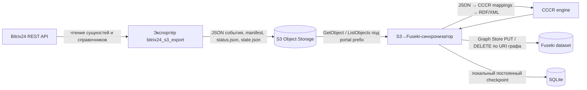
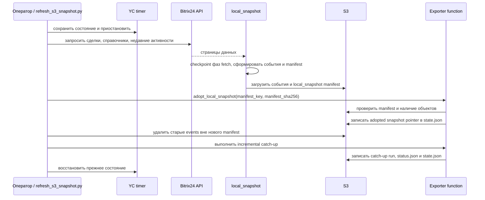
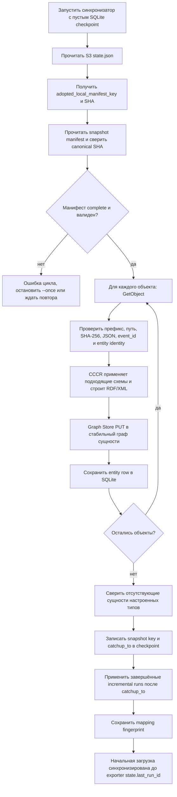
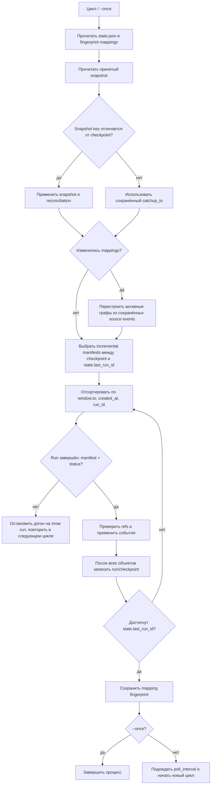

# Полная логика загрузки Bitrix24 S3 → Fuseki

Документ описывает текущий путь данных в двух проектах: экспортёр `bitrix24_s3_export` получает данные Bitrix24 и публикует неизменяемые JSON-события и манифесты в S3; S3→Fuseki-синхронизатор (исходный код подключён как submodule `cccr_pipeline`) читает этот контракт, преобразует JSON в RDF через CCCR и заменяет именованные графы в Fuseki. Синхронизатор не записывает и не удаляет объекты в S3.

Соглашения о ключах, полях событий, манифестах и проверке SHA-256 см. в [контракте интеграции](../RDF_INTEGRATION.md). Зависимости и запуск описаны в [README Semantic_BI](../README.md) и [README синхронизатора](../cccr_pipeline/README.md).

## Участники и данные

Ключевые свойства:

- **Событие** — версия сущности, а не самостоятельный граф назначения. `event_id` меняется при новой версии.
- **Манифест** — список точных ключей событий, включённых в экспортный запуск. Синхронизатор не принимает решения по произвольному листингу `events/`.
- **Идентификатор графа** — стабилен для сущности: `urn:bitrix24:entity:<portal>:<entity-type>:<sha256(entity_key)>`. Все версии этой Bitrix24-записи попадают в один граф.
- **Checkpoint** — локальная SQLite база синхронизатора. Она хранит базовый snapshot, последний применённый run ID, версию mappings и состояние каждой сущности. Её нужно сохранять между перезапусками вместе с Fuseki.

## 1. Как экспортёр публикует данные

### Регулярный incremental

Облачная функция вызывается таймером раз в 10 минут. Она читает курсоры Bitrix24 из собственного состояния (`state.json` с внутренними YDB-курсорами), выбирает изменившиеся сделки и активности, а также периодически публикуемые справочники. Окно имеет overlap и safety lag, поэтому рядом стоящие запуски могут ссылаться на одну версию повторно. Это ожидаемо: синхронизатор идемпотентен.

Для одного run экспортёр записывает JSON события в `events/<type>/<identity>/<event_id>.json`, вычисляет SHA-256 байтов и сохраняет его в S3 metadata и `objects[]` манифеста. Затем публикует `runs/<run_id>/manifest.json`; для incremental фиксирует курсоры во внутреннем state store и обновляет `state.json.last_run_id`, а в завершающей части вызова публикует `status.json`. Синхронизатор применяет run только после проверки manifest и status marker. `state.json.last_run_id` задаёт верхнюю границу просмотра, но сам по себе не доказывает успешное завершение функции.

### Создание и принятие полного локального снимка

Полное обновление — управляемая операция, отдельная от 10-минутного цикла:

1. `refresh_s3_snapshot.py` определяет прежнее состояние таймера и при необходимости приостанавливает его, чтобы регулярный incremental не пересёкся с заменой базы.
2. `local_snapshot.sh` получает данные Bitrix24 и строит возобновляемый локальный snapshot: полный набор доступных сделок и справочников плюс активности за заданное окно (обычно 90 дней).
3. Фаза upload кладёт JSON-события и полный `local_snapshot` `manifest.json` в S3. Манифест содержит `objects[]`, `counts`, `catchup_to`, `activity_from`, `complete: true` и `status: complete`.
4. Refresh вызывает облачный режим `adopt_local_snapshot` с ключом и SHA-256 манифеста. Функция проверяет снимок и принимает его: сохраняет `adopted_local_manifest_key`, SHA и границу курсоров в `state.json`. Само наличие файла в S3 ещё не делает его актуальной базой — синхронизатор ориентируется на принятый указатель.
5. После принятия exporter удаляет из `events/` файлы, которых нет в новом снимке. Исторические run-манифесты из `runs/` при этом сохраняются и могут ссылаться на уже удалённые event-файлы.
6. Экспортёр выполняет инкрементальный catch-up от границы снимка, восстанавливает таймер в его прежнее состояние и публикует актуальный `last_run_id`. Текущий скрипт передаёт catch-up запуску ID `refresh-catchup-<timestamp>`; это отличается от timestamp-prefixed ID обычного расписания и несовместимо с предположениями текущего загрузчика (см. ограничения ниже).

Управляющая последовательность refresh:

Если шаг после принятия снимка завершился ошибкой, операция не эквивалентна «откату»: принятый указатель уже может указывать на новый snapshot. Refresh специально оставляет таймер остановленным при ошибках после опасной границы, чтобы состояние можно было проверить и безопасно завершить вручную. Перед запуском такой операции проверьте документацию и актуальную реализацию `bitrix24_s3_export/README.md`.

### Backfill

`backfill` выгружает явно заданный диапазон и создаёт отдельный манифест `mode: backfill`. Он не двигает регулярные курсоры и не меняет `state.json.last_run_id`. Текущий S3→Fuseki-синхронизатор пропускает такие манифесты; наличие backfill в S3 само по себе не обновляет графы. Для применения архивной истории требуется отдельный согласованный workflow, который задаёт приоритет событий и проверяет их актуальность относительно snapshot/incremental.

## 2. Первичная полная загрузка в Fuseki

Первичная загрузка выполняется тем же S3→Fuseki-синхронизатором, который обслуживает последующие обновления. На пустом checkpoint порядок такой:

Для каждого `objects[]` синхронизатор:

1. Проверяет, что ключ расположен под разрешённым S3 `events/` префиксом и имеет форму `<entity>/<identity>/<event_id>.json`.
2. Скачивает объект, сверяет SHA-256 байтов с записью манифеста и валидирует версию события (сейчас поддерживаются schema v3 и v4), `event_id`, `graph_id`, `entity_key`, тип и identity.
3. Вычисляет стабильный URI именованного графа по `entity_key`.
4. Для `upsert` CCCR применяет все подходящие mappings, объединяет результирующие RDF-графы, сериализует RDF/XML и выполняет Graph Store `PUT`. `PUT` полностью заменяет содержимое указанного именованного графа, а не добавляет триплеты к старой версии.
5. После успешной записи в Fuseki сохраняет версию сущности в SQLite: source key, SHA, event ID, время источника, URI графа, mapping fingerprint и флаг удаления.

Для `operation: delete` выполняется Graph Store `DELETE` URI графа и сохраняется tombstone в SQLite. Однако текущий экспортёр не отправляет tombstone при обычном удалении записи в Bitrix24.

После применения snapshot выполняется reconciliation. Для настроенных `snapshot_reconcile_entity_types` локальный список активных сущностей сравнивается с набором `entity_key` снимка; отсутствующие сущности удаляются из Fuseki и помечаются удалёнными в SQLite. По умолчанию это `deal`, `user`, `category`, `stage`, `source`. `activity` намеренно исключён: snapshot содержит лишь ограниченное окно, поэтому отсутствие старой активности нельзя считать удалением.

Далее загрузчик догоняет incremental runs, завершённые после `catchup_to` snapshot-а и не позже `state.json.last_run_id`. Это закрывает промежуток между съёмкой данных и фиксацией/принятием снимка. Run применяется только целиком после готовности `status.json`; незавершённый run откладывает также последующие runs.

После первого успешного цикла checkpoint содержит принятый snapshot, границу `catchup_to`, последний применённый run и карту текущих сущностей. Не удаляйте и не пересоздавайте его при перезапуске процесса. Новый checkpoint допустим только как осознанная повторная загрузка или восстановительная процедура; сам по себе он не удалит старые графы из Fuseki.

## 3. Обычный цикл синхронизации

Каждый цикл заново читает `state.json`, вычисляет fingerprint mappings, проверяет указанный exporter-ом принятый snapshot и читает манифесты до верхней границы `last_run_id`.

Алгоритм отбора и применения incremental:

- `state.json.last_run_id` ограничивает верхний край; синхронизатор не применяет run, который экспортёр ещё не объявил текущим. Однако exporter записывает этот указатель до завершающего `status.json`, поэтому загрузчик дополнительно требует status marker `complete`.
- Снизу используется сохранённый checkpoint run ID. Если его нет, нижняя временная граница — `catchup_to` snapshot-а. Манифесты сортируются по `window.to`, затем `created_at`, затем `run_id`.
- Run с `window.to <= catchup_to` пропускается как уже представленный базовым snapshot-ом. Run `backfill` не считается регулярным incremental.
- Требуются `manifest.status == complete` и `status.json.status == complete` для одного и того же `run_id`. При отсутствующем/неуспешном status marker цикл откладывает этот run и все последующие, а не перескакивает через дыру. Это повторяется в каждом цикле; автоматического восстановления или пропуска такого run сейчас нет.
- Событие, не новее базового snapshot-а, не перезаписывает его. Более старая версия относительно уже применённой сущности также пропускается. Это защищает от overlap и неупорядоченных наблюдений.
- После всех объектов run его ID фиксируется в SQLite. Если загрузчик падает посередине, следующий запуск повторяет run; уже применённая версия распознаётся по event ID, graph URI и mapping version, а её PUT не нужен.

### Текущие ограничения run lifecycle

Скрипт замены snapshot-а вызывает catch-up incremental с явно заданным ID `refresh-catchup-<UTC timestamp>`. Загрузчик, однако, сравнивает run ID лексикографически и ожидает timestamp с начала строки для проверки возраста. После фиксации такого catch-up ID следующий обычный ID вида `YYYYMMDDTHHMMSSZ-...` может быть сочтён более старым, и цикл завершится ошибкой «Checkpoint опережает exporter state». До исправления протокола run ID замена snapshot-а может потребовать ручного восстановления checkpoint/state.

Есть и второй крайний случай: exporter публикует manifest перед фиксацией курсоров и `state.json`, а `status.json` записывает в `finally`. Если после публикации manifest выполнение завершается ошибкой, манифест остаётся со статусом `failed` (или без status marker). Когда верхняя граница `state.json.last_run_id` позже сдвинется, загрузчик увидит этот run, остановится на нём и будет откладывать последующие. Автоматического способа пометить run как восстановленный, безопасно повторить его у экспортёра или пропустить нет.

Оба случая записаны как задачи следующего этапа в [SYNC_RELIABILITY_BACKLOG.md](SYNC_RELIABILITY_BACKLOG.md). До их решения трактуйте их как ограничения текущей реализации, а не как гарантированные свойства интеграции.

Обновление существующей Bitrix24-сущности всегда адресует тот же граф. Поэтому новое событие заменяет его RDF/XML, удаляя триплеты, отсутствующие в новой проекции. Несколько сущностей одного типа не сливаются в общий граф: у каждой свой URI.

## 4. Изменение схем и восстановление

Fingerprint формируется из реестра mappings и используемых схем CCCR. Если он отличается от сохранённого значения, синхронизатор повторно строит активные графы из сохранённых event-файлов и обновляет fingerprint после завершения прохода. Элементы уже пересобранные из нового snapshot-а пропускаются. Значения источника всё ещё читаются из S3, поэтому checkpoint не является локальным архивом JSON.

Есть специальное ограничение для старых `activity`: экспортёр хранит event-объекты ограниченное время, а Fuseki может содержать активности за пределами snapshot-окна. Если исходный event-файл такой activity уже удалён из S3, пере-проекция предупреждает и оставляет граф без изменения. Для прочих типов отсутствие исходного файла считается ошибкой, цикл не завершает пере-проекцию и повторяется после исправления источника/снимка.

Обычный сбой события сохраняет checkpoint уже завершённых сущностей, но run ID остаётся незафиксированным до полного успеха. Перезапуск с тем же checkpoint безопасно повторяет незавершённое. Не запускайте два процесса синхронизации на одном checkpoint: файловая блокировка не позволит им работать одновременно. Для контейнерного запуска SQLite volume должен быть постоянным.

## 5. Удаления, границы и эксплуатационные условия

- **Удаление в S3 не означает удаление графа.** Исторические run manifests могут сохраняться после очистки event objects. Ошибка `NoSuchKey` при применении обязательного event — проблема целостности/retention, а не команда удалить сущность.
- **Удаление в Bitrix24:** exporter пока не публикует tombstone для удалённой CRM-записи. Snapshot reconciliation может обнаружить отсутствие только в типах, объявленных полными и перечисленных в конфиге. Не включайте `activity` в reconciliation при окне snapshot-а в 90 дней.
- **Backfill:** отдельный поток, сейчас игнорируется нормальным циклом; нет гарантии, что применение исторического backfill не заменит более свежее состояние.
- **Retention:** если последний обработанный exporter run больше не доступен в `runs/` или checkpoint приближается к пределу хранения событий в S3, синхронизатор завершает цикл ошибкой и требует нового принятого полного снимка. Не очищайте S3 вручную, пока не подтверждены актуальность Fuseki и checkpoint.
- **Согласованность двух систем:** Graph Store PUT/DELETE и SQLite checkpoint — отдельные записи. При падении между ними событие повторится; стабильный граф и идемпотентный PUT делают такой повтор безопасным. Неизвестный результат сетевого запроса к Fuseki также обрабатывается повтором.
- **S3 read-only:** полномочия S3 пользователя синхронизатора должны ограничиваться чтением/листингом нужного portal prefix. Изменение или удаление в S3 выполняет экспортёр/оператор отдельным процессом.

## 6. Основные файлы реализации

- Экспортёр и его инструкции: `bitrix24_s3_export/function/incremental.py`, `function/snapshot_adoption.py`, `operations/refresh.py`, `snapshot/` и `bitrix24_s3_export/README.md`.
- Потребитель S3 и Fuseki: `Semantic_BI/cccr_pipeline/rdf_sync.py`.
- Конфигурация: `Semantic_BI/cccr_pipeline/config.example.yaml` и `config.docker.example.yaml`.
- Контракт объектов, событий и доступов: [RDF_INTEGRATION.md](../RDF_INTEGRATION.md).

