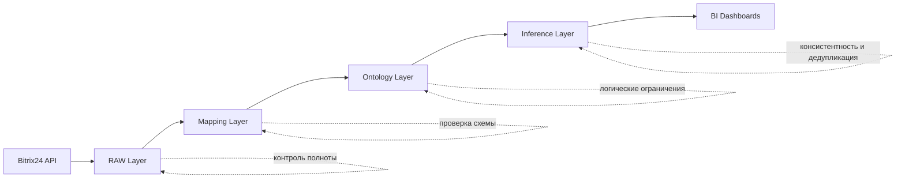

# Архитектура и дорожная карта MVP

Источник: [`docs/semantic_bi_mvp_pitch.pdf`](../docs/semantic_bi_mvp_pitch.pdf), [`docs/semantic_data_lake_architecture (1).pdf`](../docs/semantic_data_lake_architecture%20(1).pdf), [`docs/Архитектура Семантической BI-платформы.pdf`](../docs/%D0%90%D1%80%D1%85%D0%B8%D1%82%D0%B5%D0%BA%D1%82%D1%83%D1%80%D0%B0%20%D0%A1%D0%B5%D0%BC%D0%B0%D0%BD%D1%82%D0%B8%D1%87%D0%B5%D1%81%D0%BA%D0%BE%D0%B9%20BI-%D0%BF%D0%BB%D0%B0%D1%82%D1%84%D0%BE%D1%80%D0%BC%D1%8B.pdf).

## 1) Целевая архитектура MVP

### 1.1 Слои и компоненты

1. **RAW Layer** — загрузка и хранение сырья
   - **Коннектор Bitrix24 REST API**: выгрузка лидов, сделок, контактов, компаний, активностей, товаров, стадий, источников, UTM.
   - **Хранилище Data Lake**: MinIO/S3/HDFS; формат JSON; хранение «как есть».
   - **Оркестрация**: Airflow/Kafka для расписаний и событийных прогонов.

2. **Mapping Layer** — семантический маппинг
   - **CCCR v2.4**: трансляция вложенных JSON в RDF-триплы (ABox), нормализация ключей и приведение к общим понятиям домена.
   - **Слой правил маппинга**: соответствие полей CRM ↔ доменные термины.

3. **Ontology Layer** — бизнес-логика и правила
   - **OWL 2 онтология (TBox)**: классы и отношения домена «Клиент», «Компания», «Сделка», «Менеджер», «Активность», «Товар», «Источник», «Стадия», «ИсточникПривлечения».
   - **Словарь терминов домена**: единый словарь, на который ссылаются маппинги и BI-дашборды.
   - **Ограничения и аксиомы**: типы связей, кардинальности, допустимые сочетания статусов и дат.
   - **Классификационные правила**: сегменты риска, качества данных, бизнес-категории сделок и клиентов.
   - **Язык правил**: SWRL и/или SPARQL CONSTRUCT для обогащения; правила хранятся отдельно от базовой онтологии.
   - **Управление правилами**: versioning, включение/выключение, аудит и прозрачность объяснений.
   - **Изоляция правил**: хранение в Named Graphs, чтобы не менять базовую TBox.
   - **Валидация правил**: проверка на непротиворечивость перед активацией (Consistency check).
   - **Горячий пересчет**: применение новых правил к ABox без повторной выгрузки сырых данных.
   - **No-Code UI (опционально)**: пользовательский конструктор IF-THEN с трансляцией в SWRL/SPARQL.

4. **Inference Layer** — логический вывод
   - **GraphDB/Stardog + Reasoner**: Pellet/HermiT, вывод новых фактов, классификация, консистентность.
   - **Entity Resolution**: owl:sameAs для слияния сущностей из разных источников.

5. **Web UI Layer** — собственный веб‑интерфейс платформы
   - **Панели аналитики**: дашборды воронки, менеджеров, источников, качества данных.
   - **Объяснения сигналов**: «почему» с указанием правил и исходных фактов.
   - **Конструктор правил**: IF‑THEN UI, публикация и откат версий правил.
   - **Админ‑раздел**: настройка источника, расписаний, прав доступа, мониторинга загрузок.

6. **Presentation Layer** — доступ к данным для внешних BI (опционально)
   - **Интеграции**: Superset/Metabase/Yandex DataLens при необходимости.
   - **Доступ**: SPARQL/SQL виртуализация для витрин.
   - **Дашборды**: повторяют ключевые срезы Web UI при подключении внешних BI.

### 1.2 Интерфейсы и ответственность компонентов

- **Bitrix24 API → RAW**: выгрузка JSON, контроль полноты и повторов.
- **RAW → Mapping**: загрузка сырых файлов в CCCR, формирование ABox.
- **Mapping → Ontology**: сопоставление фактов с TBox, проверка терминов.
- **Ontology → Inference**: логический вывод и консистентность.
- **Inference → BI**: SPARQL/SQL доступ к итоговым срезам.

### 1.3 Сквозной поток данных и контроль качества

**Точки контроля качества**
- RAW: полнота выгрузки, дубликаты, корректность форматов даты/ID.
- Mapping: полнота маппинга, валидность связей, корректность преобразований.
- Ontology: непротиворечивость аксиом и классов.
- Inference: консистентность, корректность классификации, отсутствие конфликтов.

## 2) Дорожная карта реализации MVP

### Этап 1 — Коннектор и RAW слой
**Цель**: получить сырые данные Bitrix24 в Data Lake.
- Настроить авторизацию и выгрузку ключевых сущностей.
- Хранение JSON без трансформаций.
- Проверки полноты и повторов.

**Критерий готовности**: регулярная выгрузка данных за период с валидными JSON и метаданными по выгрузкам.

### Этап 2 — Онтология домена
**Цель**: сформировать базовые классы и связи.
- Определить классы, свойства, связи.
- Зафиксировать первичные бизнес-правила и ограничения.

**Критерий готовности**: базовая онтология, покрывающая сущности CRM и ключевые бизнес-сценарии.

### Этап 3 — Семантический маппинг
**Цель**: конвертация JSON в ABox.
- Настроить CCCR-пайплайны.
- Сопоставить ключевые поля и связи.

**Критерий готовности**: RDF-триплы с корректной связностью сущностей.

### Этап 4 — Логический вывод и граф
**Цель**: включить Reasoner и валидации.
- Развернуть GraphDB/Stardog.
- Настроить вывод, сегментацию, проверки.

**Критерий готовности**: выводимые сегменты и выявление противоречий.

### Этап 5 — Web UI платформы MVP
**Цель**: собственный веб‑интерфейс платформы.
- Дашборды: воронка, менеджеры, источники, качество данных.
- Экран объяснений сигналов и правил.
- Базовый конструктор правил IF‑THEN.

**Критерий готовности**: Web UI показывает факты, объяснения и позволяет управлять правилами.

### Этап 6 — Валидация бизнес-результатов
**Цель**: доказать ценность MVP.
- Сверка метрик с CRM.
- Подстройка правил и сегментов.

**Критерий готовности**: подтверждённая точность и полезность аналитики.

### Этап 7 — Внешние BI (опционально)
**Цель**: подключение внешних BI при необходимости.
- Подключение к SPARQL/SQL.
- Репликация дашбордов в стороннем BI.

**Критерий готовности**: внешние BI получают те же срезы, что и Web UI.

### Этап 6 — Валидация бизнес-результатов
**Цель**: доказать ценность MVP.
- Сверка метрик с CRM.
- Подстройка правил и сегментов.

**Критерий готовности**: подтверждённая точность и полезность аналитики.

## 3) Риски и допущения

- **Качество данных Bitrix24**: пропуски, неверные статусы, дубли.
- **Ограничения API**: лимиты, неполные поля, устаревшие справочники.
- **Сложность онтологии**: риск перегрузки правил на старте.
- **Entity Resolution**: возможные ошибки объединения сущностей.

## 4) Предложения по управлению рисками

- Строгая валидация на RAW и Mapping.
- Постепенное расширение онтологии.
- Ручная верификация ключевых сегментов.
- Логирование правил и причин вывода.
